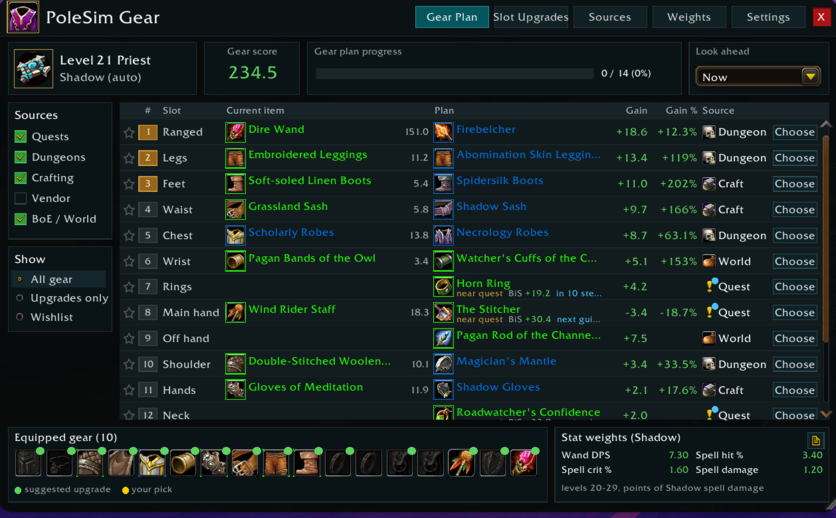
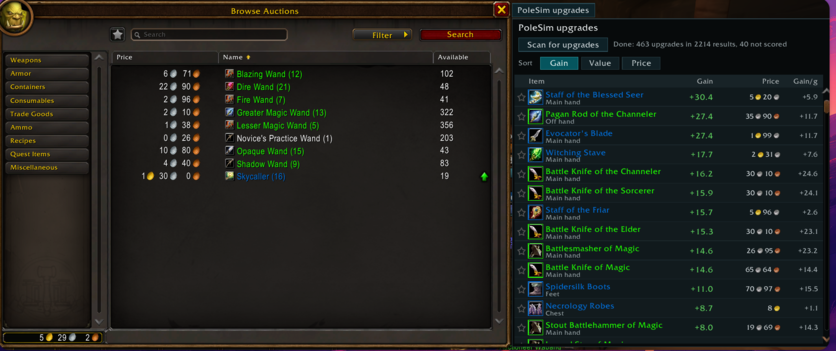

**PoleSim Gear** scores your gear for **leveling** in WoW: Forever. Its stat weights come from PoleSim, a combat simulator that levels every spec from 10 to 60 and measures what actually makes you kill faster: the weights change with your level, so a Spirit or wand point is worth what it is worth *at your level*, not at 60.

It is a companion to **Polestar** (required): it reads Polestar's item and quest data to tell you where each upgrade comes from, and points Polestar's arrow at it.

## What you get

- **A score on every item tooltip**, with a "how?" breakdown (hold **Shift**): each stat times its weight, and the gain over what you wear.
- **Green upgrade arrows** on bag items, loot rolls, merchants, mail and quest rewards, with the gain under the icon.
- **The best quest reward** marked when you turn in a quest.
- **Equip prompt:** a new upgrade in your bags asks once to be equipped (Equip / Not now).
- **The Gear Plan window** (`/psg` or the minimap button): one row per slot with the best upgrade you can get now and where it comes from (quest, dungeon boss, crafting, vendor, world drop). Upgrades from quests coming up on your Polestar route are preferred and say how many steps away they are. Pick your own plan item per slot and keep a wishlist.
- **Slot Upgrades:** every upgrade for one slot, ranked, with its level and source.
- **Sources:** where to go: dungeons, quest zones, professions and vendors, each with the upgrades they hold for you, and a waypoint to get there.
- **Look ahead:** see upgrades up to 5 levels ahead, scored with the weights for the level you will wear them at.
- **Auction house upgrades:** one click scans the auction house for upgrades you can use, sorted by gain, gain per gold, price or deals (items well below their usual price). Click a row to see its listings. Buying is always yours.
- **Weapons done right:** two-handers against main hand + off hand as one set, weapon speed for specs that care about it, daggers for Backstab rogues, bows/guns/crossbows for hunters.

## Classes and specs

Every class and spec has its own weights:

| Class | Specs |
|---|---|
| Priest | Shadow, Holy, Discipline |
| Mage | Frost, Fire, Arcane |
| Warlock | Affliction, Demonology, Destruction |
| Warrior | Arms, Fury, Protection |
| Rogue | Assassination, Combat, Subtlety |
| Hunter | Beast Mastery, Marksmanship, Survival |
| Druid | Balance, Feral, Restoration |
| Shaman | Elemental, Enhancement, Restoration |
| Paladin | Holy, Retribution, Protection |

Your spec is read from your talents (or choose it in Settings / `/psg spec`). Healer specs use leveling weights (what kills fastest while questing), not dungeon healing. Tank weights are less certain than the others; the Weights tab says so.

## Commands

- `/psg` opens the window
- `/psg spec` shows or chooses your spec
- `/psg ask` offers every upgrade in your bags
- `/psg export gear` copies your gear as one line for the PoleSim website's Armory (polesim.petllama.com)
- `/psg minimap` hides or shows the minimap button

## Privacy

- **Update notices:** PoleSim Gear joins a hidden chat channel and sends only its version number, so players on an older version hear that a newer one is out. Turn it off in Settings.
- **Recording (off unless you say yes):** you can help improve the weights by recording how your character levels (fight lengths, kills, casts, rest). Nothing is named and nothing leaves your computer by itself: every few hours you are offered a text export to paste on the PoleSim website, and you can say no. The full list of what is and isn't recorded is in the README on GitHub.

## Source and feedback

Source code (GPL-3.0) and the full manual: https://github.com/petllama/polesim-gear. Bug reports and ideas: https://github.com/petllama/polesim-gear/issues

The weights, the item finder and the dungeon finder are also on the website: https://polesim.petllama.com
